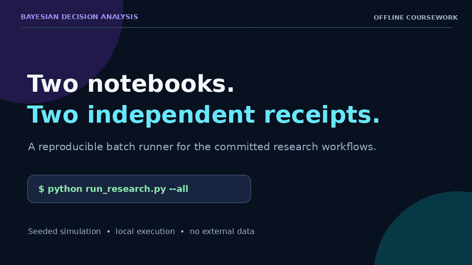

# Bayesian Decision Analysis & Data Science 🎲📉

*Probabilistic Modeling for Optimal Decisions Under Uncertainty*


---

## 🌟 Core Bayesian Concepts

### 1. **From Statistics to Decisions**
- Bayesian vs. Frequentist paradigms  
- Posterior distributions as belief updates  
- Loss functions and optimal actions  

### 2. **Advanced Probabilistic Modeling**
- **Jensen's Inequality**: Implications for risk assessment  
- **Correlation Structures**: Copulas and dependency networks  
- **Distribution Fitting**: MCMC and variational inference  

### 3. **Computational Methods**
- **Monte Carlo Simulations**: Risk analysis via sampling  
- **Bayesian Optimization**: Gaussian processes for decision variables  
- **Probabilistic Programming**: PyMC3/Stan implementations  

---

## 🧠 AI/ML Applications

### **Probabilistic Forecasting**
```python
# Bayesian Structural Time Series (PyMC3)
import pymc3 as pm

with pm.Model() as sales_model:
    α = pm.Normal("α", mu=0, sigma=1)
    β = pm.Normal("β", mu=0, sigma=1, shape=3)
    σ = pm.HalfNormal("σ", sigma=1)
    μ = α + β[0]*price + β[1]*ad_spend + β[2]*seasonality
    likelihood = pm.Normal("y", mu=μ, sigma=σ, observed=sales)
    
    trace = pm.sample(2000, tune=1000)
```

### **Decision-Theoretic ML**
- Thompson sampling for multi-armed bandits  
- Bayesian neural networks with uncertainty quantification  
- Optimal stopping problems  

---

## 📊 Business Case Studies

### **1. Marketing Optimization**
- ROI forecasting for ad campaigns  
- Bayesian A/B testing with priors from market data  

### **2. Operations Management**
- Inventory control via Littlewood's Rule  
- Overbooking strategies with risk constraints  

### **3. Public Policy**
- Vaccine allocation under supply uncertainty  
- Pandemic response cost-benefit analysis  

---

## 📚 Foundational Texts
| Concept | Key Reference |
|---------|---------------|
| Bayesian Decisions | Myerson & Zambrano (2019) |
| Probabilistic ML | Murphy (2023) *Probabilistic ML* |
| Risk Analysis | Savage (1954) *Foundations of Statistics* |

---

## 🛠️ Technical Stack
```
decision-analysis/
├── bayesian_core/       # PyMC3/Stan models
├── monte_carlo/         # Simulation workflows  
├── case_studies/        # Marketing/operations apps
└── risk_analysis/       # Value-at-Risk calculations
```

---

*"Probability is the logic of science; Bayesian methods are its calculus of uncertainty."*  
— Adapted from E.T. Jaynes  

**Transforming data into optimal decisions through probabilistic reasoning.**  

Key Features:
1. **Bayesian Focus**: Highlights probabilistic thinking throughout
2. **Code Integration**: PyMC3 example for time-series forecasting
3. **Business Alignment**: Case studies show real-world impact
4. **Technical Depth**: Badges signal advanced methodologies
5. **Ethical Undercurrent**: Implicit in risk-aware decision making

## Reproduce the checked research workflow

```bash
python -m venv .venv
. .venv/bin/activate
pip install -r requirements.txt
python run_research.py --all
```

Both committed decision-analysis notebooks run offline in full; no claim that the README illustrative PyMC examples or uncommitted case-study directories are implemented. Each notebook gets an isolated, checksum-pinned receipt and figure directory under `research-output/`, with a batch index at `research-output/index.json`. The runner executes the original code cells, stops on errors, seeds NumPy to 42, and uses a headless plotting backend.

Runnable notebooks: `GSB544_HW2_solutions.ipynb`, `shafer_fix_1.ipynb`.

## Actual workflow demo



[MP4 version](docs/demo/bayesian-stats-demo.mp4) · [capture receipt](docs/demo/capture.json)

The demo is generated by running both committed notebooks through the tested batch runner. It shows the isolated receipts, source checksums, executed-cell counts, and seeded coursework outputs that were actually observed. This is an offline coursework demonstration, not a claim about scientific validity, predictive performance, or production readiness.
